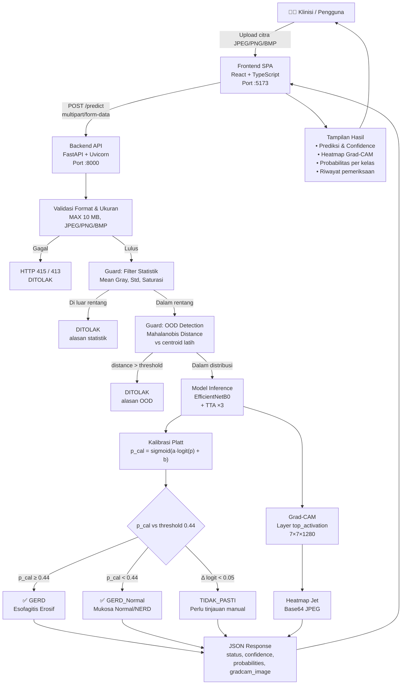
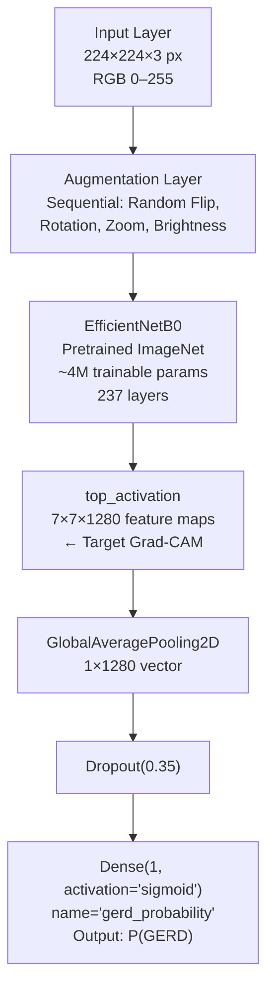
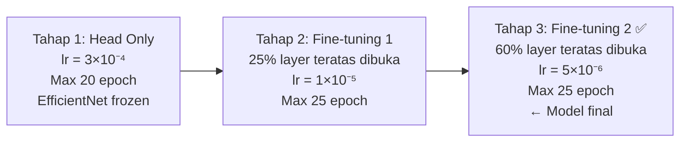
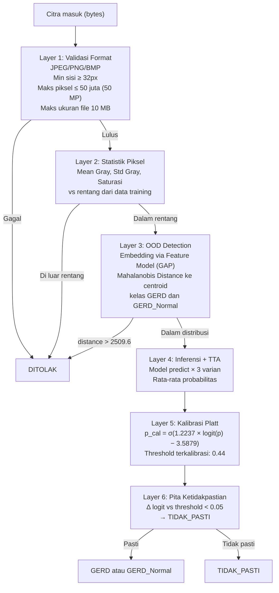
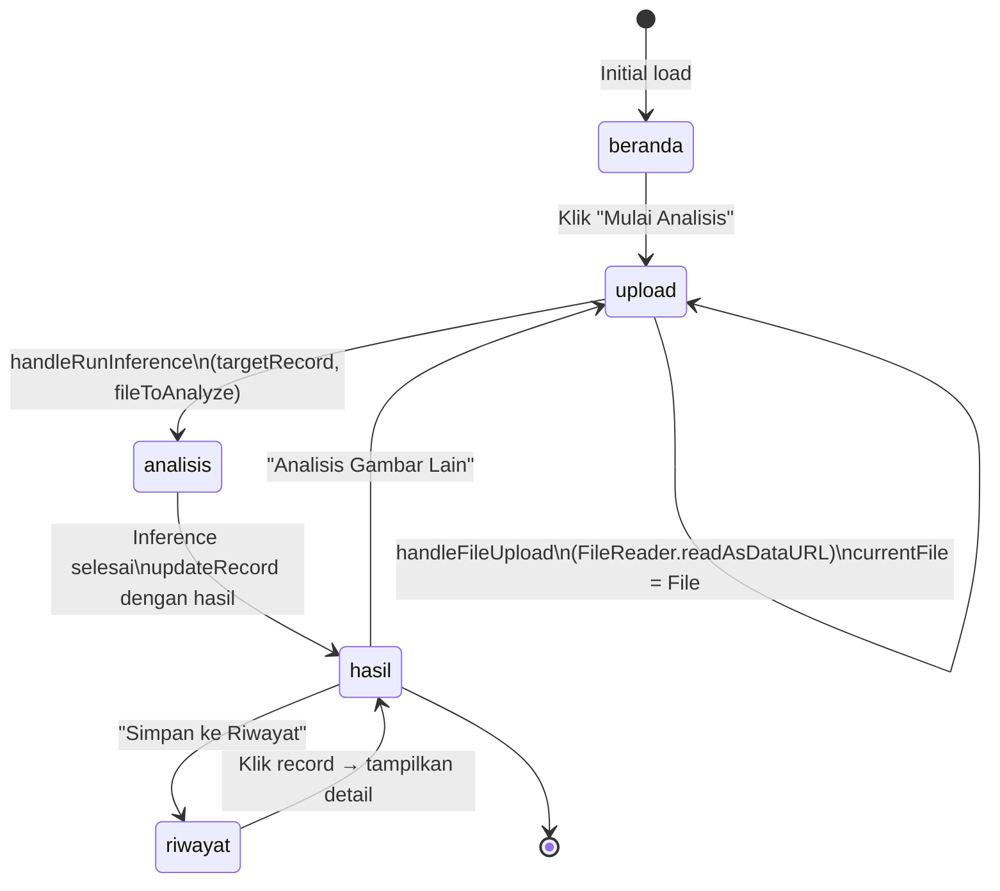

# PROJECT PROFILE
# GERD Classification — Sistem Klasifikasi Citra Endoskopi Berbasis Deep Learning

> **Versi Dokumen:** 1.0.0 · **Tanggal:** November 2026  
> **Status:** Prototipe Penelitian / Eksperimental  
> **Disclaimer:** Seluruh hasil prediksi bersifat eksperimental dan **bukan merupakan diagnosis medis**. Selalu interpretasikan bersama tenaga medis yang kompeten.

---

## Daftar Isi

1. [Ringkasan Eksekutif](#1-ringkasan-eksekutif)
2. [Latar Belakang Klinis](#2-latar-belakang-klinis)
3. [Arsitektur Sistem](#3-arsitektur-sistem)
4. [Dataset](#4-dataset)
5. [Arsitektur Model Deep Learning](#5-arsitektur-model-deep-learning)
6. [Pipeline Pelatihan](#6-pipeline-pelatihan)
7. [Performa Model](#7-performa-model)
8. [Sistem Guard (Penjaga Kualitas Input)](#8-sistem-guard-penjaga-kualitas-input)
9. [Explainable AI — Grad-CAM](#9-explainable-ai--grad-cam)
10. [Backend API](#10-backend-api)
11. [Frontend Aplikasi Web](#11-frontend-aplikasi-web)
12. [Struktur Proyek](#12-struktur-proyek)
13. [Stack Teknologi](#13-stack-teknologi)
14. [Keterbatasan & Arah Pengembangan](#14-keterbatasan--arah-pengembangan)
15. [Kesesuaian Klinis & Etika](#15-kesesuaian-klinis--etika)

---

## 1. Ringkasan Eksekutif

**GERD Classification** adalah sistem *Clinical Decision Support System* (CDSS) berbasis kecerdasan buatan yang dirancang untuk membantu klinisi dalam menganalisis citra endoskopi saluran cerna atas (*Esophagogastroduodenoscopy* / EGD). Sistem ini melakukan klasifikasi biner antara dua kelas:

| Kelas | Deskripsi Klinis |
|---|---|
| **GERD** | Esofagitis Erosif — terdapat erosi atau break mukosa esofagus distal, konsisten dengan LA Classification Grade A–D |
| **GERD Normal** | Mukosa normal / Non-Erosive Reflux Disease (NERD) — squamocolumnar junction intak tanpa defek epitel |

Sistem terdiri dari tiga lapisan utama:
1. **Model Klasifikasi** — EfficientNetB0 yang di-*fine-tune* dengan transfer learning dari ImageNet
2. **Guard System** — Pipeline filter berlapis: validasi format → statistik piksel → deteksi Out-of-Distribution (OOD) berbasis Mahalanobis distance → kalibrasi probabilitas Platt → pita ketidakpastian
3. **Antarmuka Web** — Single-Page Application (SPA) React + TypeScript yang menampilkan hasil prediksi, heatmap Grad-CAM, dan riwayat pemeriksaan

---

## 2. Latar Belakang Klinis

### Gastroesophageal Reflux Disease (GERD)

GERD adalah kondisi di mana konten lambung naik ke esofagus, menyebabkan gejala yang mengganggu dan/atau komplikasi mukosa. Secara global, GERD merupakan salah satu gangguan gastrointestinal paling umum dengan prevalensi mencapai 10–30% di populasi Barat dan terus meningkat di Asia.

### Standar Klinis yang Diikuti

Sistem ini mengacu pada dua standar internasional utama:

- **Lyon Consensus 2.0 (2021)** — Kerangka diagnostik GERD berbasis bukti yang mengklasifikasikan temuan endoskopi, pH-metri, dan manometri esofagus
- **Los Angeles (LA) Classification** — Sistem penilaian esofagitis erosif yang paling luas digunakan:
  - **Grade A:** Satu atau lebih *mucosal breaks* ≤5 mm yang tidak meluas antar puncak *mucosal folds*
  - **Grade B:** Satu atau lebih *mucosal breaks* >5 mm tanpa kontinuitas antar puncak
  - **Grade C:** *Mucosal breaks* kontinyu antar puncak ≥2 *mucosal folds*, melibatkan <75% sirkumferensi
  - **Grade D:** *Mucosal breaks* melibatkan ≥75% sirkumferensi lumen

### Relevansi AI dalam Endoskopi

Interpretasi citra endoskopi memerlukan keahlian tinggi dan pengalaman yang signifikan. Sistem AI seperti ini bertujuan untuk:
- Memberikan *second opinion* otomatis yang konsisten
- Mengurangi variasi antar pengamat (*inter-observer variability*)
- Mendukung dokter junior di fasilitas tanpa ahli gastroenterologi senior
- Mempercepat alur kerja pemeriksaan dalam volume tinggi

---

## 3. Arsitektur Sistem



---

## 4. Dataset

### Komposisi

| Split | Total | GERD_Normal | GERD |
|---|---|---|---|
| **Train** | 8.886 | 4.719 (53,1%) | 4.167 (46,9%) |
| **Validation** | 1.778 | 944 (53,1%) | 834 (46,9%) |
| **Test** | 1.778 | 944 (53,1%) | 834 (46,9%) |
| **Total** | **12.462** | **6.607** | **5.835** |

> [!NOTE]
> Dataset awal mengandung 10 sampel duplikat dan 10 sampel konflik label yang telah dihapus sebelum splitting, sehingga total bersih adalah 12.462 citra.

### Karakteristik Splitting

- **Metode:** Stratified split (menjaga distribusi kelas antar split)
- **Grouped split:** Tidak diterapkan — setiap citra diperlakukan independen
- **Format gambar:** JPEG/PNG, resolusi bervariasi (di-*resize* ke 224×224 saat inferensi)
- **Rentang statistik distribusi training** (dipakai oleh Guard):
  - Mean gray: **40.01 – 191.8**
  - Std gray: **19.93 – 93.2**
  - Saturasi: **0.1456 – 0.623**

### Catatan Klinis tentang Dataset

Citra endoskopi memiliki karakteristik visual yang khas: dominasi warna merah-merah muda, pencahayaan internal (*white-balance* endoskop), distorsi lensa *fisheye* ringan, dan *specular highlights* pada mukosa basah. Variasi ini dicerminkan dalam rentang statistik Guard di atas.

---

## 5. Arsitektur Model Deep Learning

### Diagram Arsitektur



### Komponen Utama

| Komponen | Spesifikasi |
|---|---|
| **Base model** | EfficientNetB0 (pretrained ImageNet) |
| **Input shape** | `(None, 224, 224, 3)` — RGB, nilai 0–255 |
| **Rescaling** | Internal EfficientNet (tidak perlu normalisasi manual) |
| **Augmentation** | Random flip, rotation, zoom, brightness adjustment |
| **Pooling** | GlobalAveragePooling2D |
| **Regularisasi** | Dropout rate = 0.35, L2 = 0.0001 |
| **Output layer** | Dense(1, sigmoid), nama: `gerd_probability` |
| **Label mapping** | `GERD_Normal=0`, `GERD=1` |
| **Layer Grad-CAM** | `efficientnetb0/top_activation` — shape `(7, 7, 1280)` |
| **Label smoothing** | 0.0 (tidak digunakan) |

### EfficientNetB0

EfficientNetB0 merupakan arsitektur CNN yang dioptimasi menggunakan *compound scaling* — menyeimbangkan kedalaman, lebar, dan resolusi jaringan secara proporsional. Karakteristik kunci:
- **7.1 juta total parameter** dengan efisiensi komputasi tinggi
- **MBConv (Mobile Inverted Bottleneck)** sebagai blok utama dengan *Squeeze-and-Excitation*
- **Swish activation** di seluruh layer
- Cocok untuk deployment pada hardware terbatas (CPU inference)

---

## 6. Pipeline Pelatihan

### Strategi Transfer Learning Bertahap

Pelatihan dilakukan dalam **3 tahap** dengan progressive unfreezing:



| Parameter | Nilai |
|---|---|
| **Batch size** | 16 |
| **Loss function** | Binary crossentropy |
| **Optimizer** | Adam (inferensi dari lr config) |
| **Early stopping patience** | 6 epoch |
| **TTA saat evaluasi** | ✅ Aktif (3 varian: original + h-flip + v-flip) |
| **Threshold selection metric** | `recall_target` (prioritas sensitivitas) |
| **Target recall minimum** | 0.90 |
| **Target ROC-AUC minimum** | 0.95 |
| **Selected stage** | Fine-tuning 2 |

### Test-Time Augmentation (TTA)

Saat inferensi, setiap citra diproses dalam **3 varian** secara paralel dalam satu batch:
1. Citra asli
2. Flip horizontal (`x[:, :, ::-1, :]`)
3. Flip vertikal (`x[:, ::-1, :, :]`)

Probabilitas final dirata-rata dari ketiga varian, meningkatkan stabilitas prediksi.

---

## 7. Performa Model

### Metrik Evaluasi pada Test Set (n=1.778)

| Metrik | Nilai | 95% CI |
|---|---|---|
| **Akurasi** | 87.96% | — |
| **Balanced Accuracy** | 88.16% | — |
| **Sensitivitas (Recall GERD)** | 91.25% | [89.4%, 93.1%] |
| **Spesifisitas** | 85.06% | [82.8%, 87.4%] |
| **Presisi** | 84.37% | — |
| **F1-Score** | 87.67% | [86.0%, 89.3%] |
| **ROC-AUC** | **95.10%** | [94.2%, 96.0%] |
| **PR-AUC** | 94.79% | — |
| **MCC** | 0.7617 | — |
| **Brier Score** | 0.1862 | — (lebih kecil lebih baik) |

> [!IMPORTANT]
> Model memprioritaskan **sensitivitas tinggi (91.25%)** dengan menggunakan `recall_target` sebagai threshold selection metric. Ini berarti sistem lebih memilih false positive (normal dilaporkan sebagai GERD) daripada false negative (GERD terlewat), konsisten dengan prinsip klinis *"better safe than sorry"* untuk skrining.

### Confusion Matrix (Test Set, n=1.778)

```
                    Prediksi
                  GERD_Normal   GERD
Aktual GERD_Normal    803       141    (944 total)
Aktual GERD            73       761    (834 total)
```

- **True Negative (TN):** 803 — Normal benar diprediksi Normal
- **False Positive (FP):** 141 — Normal salah diprediksi GERD
- **False Negative (FN):** 73 — GERD terlewat (kasus paling kritis)
- **True Positive (TP):** 761 — GERD benar terdeteksi

### Perbandingan Target vs Hasil

| Metrik | Target | Validasi | Test | Status |
|---|---|---|---|---|
| Accuracy | 0.90 | 88.19% | 87.96% | ⚠️ Sedikit di bawah target |
| Recall | 0.90 | 92.57% | 91.25% | ✅ Tercapai |
| ROC-AUC | 0.95 | 95.37% | 95.10% | ✅ Tercapai |

### Performa Selektif (dengan Guard)

Ketika Guard aktif, sampel yang "tidak pasti" dikeluarkan:

| Mode | Coverage | n | Accuracy | Recall | Specificity |
|---|---|---|---|---|---|
| **Selektif (Guard aktif)** | 99.60% | 1.747 | 89.41% | 90.34% | 88.59% |
| **Semua dijawab** | 100% | 1.754 | 89.22% | 90.13% | 88.42% |

---

## 8. Sistem Guard (Penjaga Kualitas Input)

Guard adalah lapisan keamanan berlapis yang berjalan **sebelum** inferensi model, memastikan hanya citra endoskopi yang valid dan dalam distribusi training yang diproses.

### Lapisan Filter Guard



### Kalibrasi Probabilitas (Platt Scaling)

Model mentah menghasilkan probabilitas yang kurang terkalibrasi (overconfident). Kalibrasi Platt memperbaiki ini:

$$p_{\text{cal}} = \sigma\!\bigl(a \cdot \text{logit}(p_{\text{raw}}) + b\bigr)$$

| Parameter | Nilai |
|---|---|
| **a (slope)** | 1.2237077 |
| **b (intercept)** | −3.5878767 |
| **Threshold raw model** | 0.89 |
| **Threshold terkalibrasi** | 0.44 |
| **Log-loss sebelum kalibrasi** | 0.5971 |
| **Log-loss sesudah kalibrasi** | 0.2489 (↓ 58.3%) |

> [!TIP]
> Threshold berubah drastis dari 0.89 → 0.44 pasca kalibrasi karena Platt scaling menyesuaikan distribusi probabilitas agar mencerminkan frekuensi kelas yang sebenarnya. Ini adalah perilaku yang diharapkan, bukan anomali.

### Statistik OOD Detection

| Metode OOD | n Uji | Rejection Rate | AUROC |
|---|---|---|---|
| OOD sintetik | 500 | 98.4% | 0.978 |
| CIFAR-100 (foto umum) | 2.000 | **100%** | 0.9999 |

- **ID acceptance rate (valid test set):** 98.65% — hanya 1.35% citra endoskopi valid yang ditolak Guard
- **OOD threshold:** 2.509,6 (Mahalanobis squared distance)

### Status Output Guard

| Status | Deskripsi | Tindakan yang Direkomendasikan |
|---|---|---|
| `GERD` | Terdeteksi Esofagitis Erosif dengan kepercayaan tinggi | Evaluasi klinis lanjut, pertimbangkan terapi PPI |
| `GERD_Normal` | Mukosa esofagus normal / NERD dengan kepercayaan tinggi | Monitoring, evaluasi gejala fungsional |
| `TIDAK_PASTI` | Skor terlalu dekat dengan batas keputusan (Δ logit < 0.05) | Wajib ditinjau langsung oleh tenaga medis |
| `DITOLAK` | Citra tidak valid, di luar distribusi, atau kualitas buruk | Unggah ulang dengan citra endoskopi yang sesuai |

---

## 9. Explainable AI — Grad-CAM

### Latar Belakang

Gradient-weighted Class Activation Mapping (Grad-CAM) adalah teknik XAI yang menghasilkan heatmap visualisasi menunjukkan **area citra yang paling berpengaruh** terhadap keputusan model. Ini penting dalam konteks medis untuk verifikasi bahwa model memperhatikan area anatomis yang relevan secara klinis.

### Implementasi Teknis

```mermaid
flowchart LR
    IMG["Citra Input\n224×224×3"] --> EFF["EfficientNetB0\nbody"]
    EFF --> CONV["top_activation\n7×7×1280\nfeature maps F"]
    CONV --> HEAD["Grad-CAM Head\nGAP → Dropout → Dense"]
    HEAD --> SCORE["Skor GERD\nP(GERD)"]
    SCORE -->|"∂Score/∂F"| GRAD["Gradien terhadap\nfeature maps"]
    GRAD -->|"Global Average\nPool gradien"| WEIGHTS["Bobot α_k\n1×1×1280"]
    WEIGHTS -->|"Σ α_k × F_k + ReLU"| RAW["Heatmap kasar\n7×7"]
    RAW -->|"Resize bilinear\n224×224"| NORM["Normalisasi\n0–1"]
    NORM -->|"Jet colormap\n(merah=panas)"| HEAT["Heatmap berwarna\n224×224×3 RGB"]
    HEAT -->|"Overlay 40%\npada citra asli"| OUT["Output:\nBase64 JPEG"]
```



### Detail Implementasi

- **Target layer:** `efficientnetb0/top_activation` (output shape `(7, 7, 1280)`)
- **Sub-model Grad-CAM:** Dibangun terpisah menggunakan `tf.keras.Input` pada EfficientNetB0 output shape untuk kompatibilitas `tf.GradientTape`
- **Colormap:** Jet (biru=rendah → hijau → kuning → merah=tinggi) — diimplementasikan secara manual dengan numpy tanpa dependensi matplotlib
- **Overlay:** Alpha blending 40% heatmap pada citra asli (opacity heatmap: 0.4)
- **Encoding:** JPEG quality 85, dikodekan sebagai Base64 data URI (`data:image/jpeg;base64,...`)

### Interpretasi Klinis Grad-CAM

Area **merah/panas** pada heatmap menunjukkan region yang paling mempengaruhi keputusan GERD. Secara klinis, ini diharapkan berkorespondensi dengan:
- Mucosal breaks atau erosi di Z-line / squamocolumnar junction
- Perubahan warna mukosa esofagus distal
- Hilangnya pola vaskular normal

---

## 10. Backend API

### Teknologi

| Komponen | Teknologi | Versi |
|---|---|---|
| Framework | FastAPI | ≥0.100 |
| ASGI server | Uvicorn | ≥0.30 |
| ML framework | TensorFlow | 2.21.x |
| Image processing | Pillow (PIL) | ≥10.0 |
| Numerik | NumPy | ≥1.24 |
| Runtime | Python | 3.11 |

### Endpoint API

#### `GET /`
```json
{
  "message": "GERD Classification API aktif",
  "docs": "/docs",
  "health": "/health"
}
```

#### `GET /health`
```json
{
  "status": "ok",
  "model_loaded": true,
  "guard_loaded": true,
  "model_path": "model_gerd_lanjutan.keras",
  "image_size": [224, 224],
  "threshold": 0.44,
  "tta": true
}
```

#### `POST /predict`

**Request:** `multipart/form-data`

| Field | Tipe | Keterangan |
|---|---|---|
| `file` | `UploadFile` | Citra endoskopi (JPEG/PNG/BMP, maks 10 MB) |

**Response sukses (GERD atau GERD_Normal):**
```json
{
  "status": "GERD",
  "prediction": "GERD",
  "category": "GERD",
  "primary_result": "Esofagitis Erosif Terdeteksi",
  "confidence": 0.998123,
  "probabilities": {
    "GERD_Normal": 0.001877,
    "GERD": 0.998123
  },
  "alasan": "",
  "warnings": [],
  "gradcam_image": "data:image/jpeg;base64,/9j/...",
  "threshold": 0.44,
  "skor_gerd": 0.998123,
  "skor_mentah": 0.996541,
  "jarak_ood": 2360.4,
  "filename": "endoscopy.jpg",
  "model": "EfficientNetB0",
  "disclaimer": "Hasil ini merupakan prediksi model, bukan diagnosis medis..."
}
```

**Response ditolak:**
```json
{
  "status": "DITOLAK",
  "prediction": "DITOLAK",
  "alasan": "Fitur gambar terlalu jauh dari citra latih menurut ambang OOD.",
  "jarak_ood": 9708.2,
  "confidence": null,
  "probabilities": null,
  "gradcam_image": null
}
```

### Konfigurasi CORS

```
allow_origins: ["http://localhost:3000", "http://127.0.0.1:3000"]
allow_methods: ["GET", "POST"]
allow_headers: ["*"]
allow_credentials: true
```

### Thread Safety

Keras inference tidak aman untuk dipanggil secara paralel pada model yang sama. Backend menggunakan `threading.Lock` (`inference_lock`) untuk memastikan hanya satu request diproses pada satu waktu. Request tambahan akan menunggu dalam antrian.

---

## 11. Frontend Aplikasi Web

### Teknologi

| Komponen | Teknologi | Versi |
|---|---|---|
| UI Framework | React | 19.0.1 |
| Language | TypeScript | 7.0.2 |
| Build tool | Vite | 8.3.5 |
| Styling | Tailwind CSS | 4.3.3 |
| Animation | Motion (Framer Motion) | 12.23.24 |
| Icons | Lucide React | 0.546.0 |
| Plugin React | @vitejs/plugin-react | 6.1.2 |
| Plugin Tailwind | @tailwindcss/vite | 4.3.3 |

### Modul / Halaman Aplikasi

Aplikasi berbasis Single Page Application (SPA) dengan navigasi state-based (bukan routing URL):

| ID | Nama Modul | Fungsi |
|---|---|---|
| `login` | Login / Masuk | Autentikasi pengguna (UI mock) |
| `beranda` | Beranda | Landing page, overview sistem |
| `upload` | Upload Gambar | Pemilihan dan upload citra endoskopi |
| `analisis` | Proses Analisis | Tampilan progress inferensi neural network |
| `hasil` | Hasil Prediksi | Visualisasi hasil: label, confidence, Grad-CAM, probabilitas |
| `riwayat` | Riwayat | Daftar semua riwayat pemeriksaan |
| `profil` | Profil Pengguna | Data dokter, edit profil, logout |

### Komponen Utama

```
src/app/
├── page.tsx              # Root orchestrator — state management utama
├── layout.tsx            # Layout wrapper HTML
├── globals.css           # Global CSS (Tailwind directives)
├── components/
│   ├── Header.tsx        # Navigation bar & modul switcher
│   ├── Hero.tsx          # Landing beranda dengan statistik performa model
│   ├── Workspace.tsx     # Upload area + thumbnail browser riwayat
│   ├── Analyzer.tsx      # Tampilan hasil: dual-image (input vs Grad-CAM), probabilitas
│   ├── Guide.tsx         # SOP & panduan penggunaan interaktif
│   ├── Footer.tsx        # Footer dengan disclaimer
│   ├── ModuleBar.tsx     # Navigation bar bawah (mobile)
│   └── Icon.tsx          # Material Icons wrapper
└── lib/
    ├── api.ts            # HTTP client — runInference(), fallback simulasi
    └── data.ts           # Type definitions & data statis (sample records, SOP, dll)
```

### Alur State Utama (`page.tsx`)



### Penanganan Citra

**Problem lama (URL.createObjectURL):** Blob URL dapat menjadi invalid setelah state update karena React re-render, menyebabkan citra tidak tampil.

**Solusi yang diterapkan:** `FileReader.readAsDataURL()` mengkonversi file ke Base64 data URI yang persisten dalam memori:

```typescript
const reader = new FileReader();
reader.onload = (e) => {
  const dataUrl = e.target?.result as string; // "data:image/jpeg;base64,..."
  // Simpan ke state — persisten sepanjang siklus hidup komponen
};
reader.readAsDataURL(file);
```

### Optimasi Rendering

- **Cache busting:** `key={`side-input-${inputImage}`}` pada `` memaksa React meremount elemen saat source berubah
- **Error guard:** `onError` handler pada `` hanya mengganti source ke placeholder jika source bukan data URI (menghindari override citra yang diupload)
- **Closure bug prevention:** `handleRunInference` menerima `targetRecord` dan `fileToAnalyze` secara eksplisit untuk menghindari stale closure atas state

---

## 12. Struktur Proyek

```
GERD Classification/
│
├── README.md                          # Quick-start guide operasional
├── PROJECT_PROFILE.md                 # ← Dokumen ini
├── guide.md                           # Panduan penggunaan lengkap
├── .gitignore                         # Root gitignore (Frontend + Backend)
│
├── backend/                           # Python FastAPI service
│   ├── main.py                        # Entry point API, endpoint /predict & /health
│   ├── guard.py                       # GERDGuard class (validasi + OOD + kalibrasi + Grad-CAM)
│   ├── image_type_gate.py             # (Opsional) gate tipe citra tambahan
│   ├── requirements.txt               # Python dependencies
│   ├── .gitignore                     # Backend gitignore
│   │
│   ├── model/
│   │   ├── lanjutan/
│   │   │   ├── model_gerd_lanjutan.keras          # Model utama (47.7 MB)
│   │   │   ├── model_gerd_efficientnetb0_config.json  # Konfigurasi training
│   │   │   └── hasil_ui.json                      # Metrik evaluasi lengkap + data kurva
│   │   ├── guard/
│   │   │   ├── gerd_guard.npz                     # Parameter Guard (mu, precision, stat) (5.8 MB)
│   │   │   └── gerd_guard_config.json             # Konfigurasi Guard (Platt, threshold, OOD)
│   │   └── image_gate/
│   │       ├── image_type_classifier.keras        # Classifier tipe citra opsional
│   │       └── image_type_config.json
│   │
│   └── testing_guard/
│       ├── valid_endoscopy/                       # Citra endoskopi valid untuk uji Guard
│       └── foreign_images/                        # Citra non-medis untuk uji penolakan OOD
│
└── frontend/                          # React + TypeScript SPA
    ├── index.html                     # HTML entrypoint
    ├── vite.config.ts                 # Vite build config (proxy ke backend)
    ├── tsconfig.json                  # TypeScript config
    ├── package.json                   # NPM dependencies
    ├── .env.example                   # Template environment variables
    ├── .gitignore                     # Frontend gitignore
    ├── metadata.json                  # Project metadata
    │
    ├── public/
    │   ├── img/                       # Sample/demo images
    │   │   ├── input.jpg              # Sample endoscopy (GERD)
    │   │   ├── gradcam.jpg            # Sample Grad-CAM heatmap
    │   │   ├── thumb-gerd.jpg         # Thumbnail GERD sample
    │   │   ├── thumb-normal.jpg       # Thumbnail normal sample
    │   │   ├── thumb-polip.jpg        # Thumbnail polyp sample
    │   │   ├── thumb-antrum.jpg       # Thumbnail antrum sample
    │   │   ├── sampel-zline.jpg       # Sample Z-line image
    │   │   └── dokter.jpg             # Doctor avatar (dummy)
    │   └── assets/
    │
    └── src/
        ├── main.tsx                   # Vite entrypoint
        ├── App.tsx                    # App root wrapper
        ├── index.css                  # Base CSS
        └── app/
            ├── page.tsx               # Root page (state management utama)
            ├── layout.tsx             # HTML layout
            ├── globals.css            # Global Tailwind CSS
            ├── components/
            │   ├── Header.tsx
            │   ├── Hero.tsx
            │   ├── Workspace.tsx
            │   ├── Analyzer.tsx
            │   ├── Guide.tsx
            │   ├── Footer.tsx
            │   ├── ModuleBar.tsx
            │   └── Icon.tsx
            └── lib/
                ├── api.ts             # Backend API client + inference runner
                └── data.ts            # Data types, constants, sample records
```

---

## 13. Stack Teknologi

### Backend

| Teknologi | Versi | Fungsi |
|---|---|---|
| Python | 3.11 | Runtime |
| TensorFlow/Keras | 2.21.x | Model loading, inference, Grad-CAM |
| FastAPI | ≥0.100 | REST API framework |
| Uvicorn | ≥0.30 | ASGI server |
| Pillow (PIL) | ≥10.0 | Image decode, EXIF handling, resize |
| NumPy | ≥1.24 | Numerical computing, heatmap generation |
| python-multipart | ≥0.0.9 | File upload parsing |

### Frontend

| Teknologi | Versi | Fungsi |
|---|---|---|
| React | 19.0.1 | UI framework |
| TypeScript | 7.0.2 | Type safety |
| Vite | 8.3.5 | Build tool & dev server |
| Tailwind CSS | 4.3.3 | Utility-first styling |
| @tailwindcss/vite | 4.3.3 | Tailwind integration plugin |
| @vitejs/plugin-react | 6.1.2 | React HMR support |
| Motion | 12.23.24 | Animation library (Framer Motion successor) |
| Lucide React | 0.546.0 | Icon library |

### Infrastruktur Dev

| Tool | Fungsi |
|---|---|
| Python venv (`backend/.venv/`) | Isolasi dependensi Python |
| npm / node_modules | Manajemen dependensi JavaScript |
| Vite Dev Server (:5173) | Frontend development dengan HMR |
| Uvicorn (:8000) | Backend API server |
| Vite proxy config | Forward `/api/*` ke backend selama development |

---

## 14. Keterbatasan & Arah Pengembangan

### Keterbatasan Saat Ini

| Keterbatasan | Dampak | Catatan |
|---|---|---|
| **Klasifikasi biner saja** | Tidak dapat membedakan Grade LA (A/B/C/D) | Diperlukan dataset yang lebih detail dengan grading |
| **Dataset tidak di-grupkan** | Potensi data leakage jika ada citra dari pasien yang sama di split berbeda | Perlu rekonfigurasi splitting berbasis pasien |
| **CPU-only inference** | Inference 3–5 detik per citra (TTA) | GPU deployment akan 10–20× lebih cepat |
| **Thread lock tunggal** | Throughput terbatas untuk multi-user | Perlu worker pool atau queue system (Celery/RQ) |
| **Tidak ada database** | Riwayat hilang saat refresh — disimpan di React state saja | Perlu backend storage (PostgreSQL, SQLite) |
| **Tidak ada autentikasi nyata** | Login hanya UI mock | Perlu integrasi OAuth/JWT |
| **Hanya endoskopi EGD** | Tidak tervalidasi untuk tipe endoskopi lain (kolonoskopi, dll.) | Setiap modalitas butuh model tersendiri |
| **OOD threshold perlu tuning** | Beberapa citra endoskopi valid (terang/gelap) terkadang ditolak | Threshold dinaikkan dengan heuristik `max(ood_threshold × 1.8, 4800)` |
| **Tidak ada eksplainabilitas teks** | Grad-CAM hanya visual; tidak ada deskripsi linguistik temuan | Perlu integrasi LLM/VLM untuk narasi otomatis |

### Arah Pengembangan Potensial

1. **Multi-class LA Grading** — Perluas ke klasifikasi Grade A/B/C/D dengan dataset berlabel detail
2. **Segmentasi mukosa** — Tambahkan U-Net/Mask R-CNN untuk delineasi eksak area erosi
3. **Report generation otomatis** — Integrasi LLM (Gemini/GPT-4V) untuk draft laporan endoskopi
4. **Deployment cloud** — Containerisasi dengan Docker, deployment ke GCP/AWS dengan GPU inference
5. **Mobile-first** — PWA atau aplikasi mobile React Native untuk akses di tablet endoskopi
6. **Database & audit trail** — PostgreSQL + sistem log untuk keperluan regulatory compliance
7. **Multi-modal** — Integrasi data klinis (gejala, pH-metri, manometri) untuk prediksi holistik
8. **Federated learning** — Training terdistribusi lintas rumah sakit tanpa berbagi data pasien

---

## 15. Kesesuaian Klinis & Etika

### Posisi Regulasi

Sistem ini adalah **prototipe penelitian** dan **belum tersertifikasi** sebagai alat medis (Software as Medical Device / SaMD) sesuai:
- **BPOM RI** — Peraturan BPOM No. 7 Tahun 2020 tentang Alat Kesehatan Berbasis Teknologi
- **FDA 510(k)/De Novo** — Untuk pasar AS
- **CE MDR (EU 2017/745)** — Untuk pasar Eropa

### Disclaimer Medis

> ⚠️ **PENTING:** Seluruh output sistem ini — termasuk prediksi, confidence score, dan heatmap Grad-CAM — **bersifat eksperimental dan tidak dapat digunakan sebagai dasar diagnosis atau keputusan terapeutik**. Hasil harus selalu diinterpretasikan oleh dokter atau tenaga medis yang memiliki kompetensi di bidang gastroenterologi/endoskopi. Penggunaan di luar konteks penelitian sepenuhnya menjadi tanggung jawab pengguna.

### Prinsip Etika AI yang Diterapkan

| Prinsip | Implementasi |
|---|---|
| **Transparansi** | Grad-CAM menampilkan "alasan" visual keputusan model |
| **Keselamatan** | Guard menolak input yang tidak dalam distribusi training |
| **Kalibrasi** | Platt scaling memastikan probabilitas mencerminkan frekuensi kejadian nyata |
| **Kehati-hatian** | Mode `TIDAK_PASTI` mencegah keputusan otomatis pada kasus borderline |
| **Human-in-the-loop** | Semua output dirancang untuk diinterpretasi bersama klinisi, bukan menggantikan |
| **Keterbukaan keterbatasan** | Disclaimer eksplisit di setiap respons API dan di seluruh UI |

---

*Dokumen ini dibuat secara otomatis berdasarkan analisis mendalam terhadap seluruh source code, konfigurasi model, dan data evaluasi proyek GERD Classification.*

*Kontak & kontribusi: Lihat `README.md` untuk panduan operasional, dan `guide.md` untuk panduan penggunaan lengkap.*

